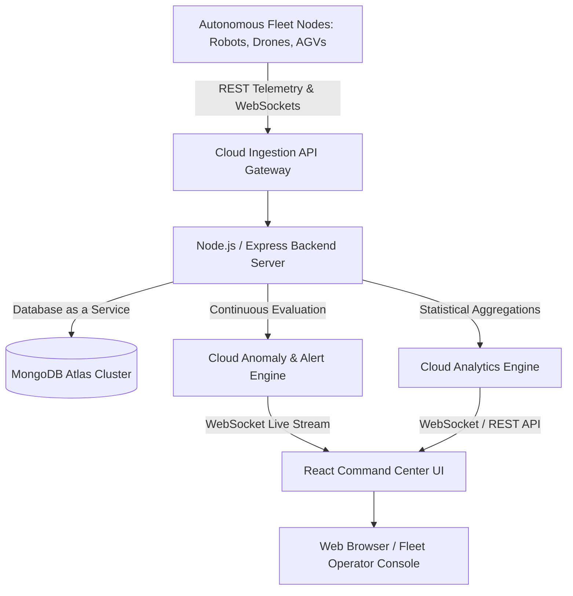

# ☁️ AutoCloud – Cloud-Based Autonomous System Management Platform

[](https://opensource.org/licenses/MIT)
[](https://nodejs.org/)
[](https://reactjs.org/)
[](https://www.mongodb.com/atlas)
[](https://socket.io/)
[](https://tailwindcss.com/)

> **Academic Subject:** Cloud Computing for Autonomous Systems  
> **Project Goal:** Centralized cloud telemetry ingestion, real-time fleet orchestration, automated anomaly detection, and mission dispatch for heterogeneous autonomous robots, drones, and smart vehicles.  
> **Hardware Status:** Simulated Telemetry Engine (Zero Physical Hardware Dependency).

---

## 📌 1. Project Overview

**AutoCloud** is a production-grade full-stack cloud computing web application designed to demonstrate how modern cloud infrastructure supports autonomous robotics and vehicular fleets. 

Autonomous systems—such as delivery robots, aerial drones, AGVs, and self-driving vehicles—generate high-velocity sensor data. AutoCloud ingests, stores, evaluates, and visualizes this data in real time through decoupled cloud REST APIs, MongoDB Atlas Database-as-a-Service (DBaaS), and bi-directional WebSocket pipes.

```
+-----------------------------------------------------------------------------------+
|                           AUTONOMOUS SYSTEMS FLEET                                |
|  [🤖 Delivery Robots]   [🛸 Sky Drones]   [🚚 Heavy AGVs]   [🚗 Autonomous EVs]   |
+-----------------------------------------------------------------------------------+
                                         │
                                         ▼ (HTTP POST / WebSocket Ingestion)
+-----------------------------------------------------------------------------------+
|                                CLOUD API GATEWAY                                  |
|         Node.js / Express.js REST API + Socket.IO Broadcast Server                |
+-----------------------------------------------------------------------------------+
                     │                                           │
                     ▼                                           ▼
+------------------------------------+       +------------------------------------+
|       MONGODB ATLAS (DBaaS)        |       |       ALERT & ANALYTICS ENGINE     |
| • Telemetry Time-Series Collection |       | • Low Battery (< 20%)              |
| • Fleet Devices Inventory          |       | • Core Thermal Overheat (> 70°C)   |
| • Mission Orchestration State      |       | • Weak Mesh Signal (< 30%)         |
| • JWT Authenticated Accounts       |       | • Offline Heartbeat Monitor (>60s) |
+------------------------------------+       +------------------------------------+
                     │                                           │
                     └───────────────────┬───────────────────────┘
                                         │ (Sub-50ms Real-Time Push)
                                         ▼
+-----------------------------------------------------------------------------------+
|                         REACT COMMAND CENTER DASHBOARD                            |
|    • Interactive Fleet Radar Map (Leaflet)     • Live Telemetry Waveform Charts   |
|    • Mission Dispatch & Waypoints Timelines    • Incident Resolution Console      |
|    • Multi-Tenant Role Security (Admin/Op)     • Live Viva Anomaly Test Injector  |
+-----------------------------------------------------------------------------------+
```

---

## 🏗️ 2. Mermaid System Architecture



---

## ☁️ 3. Cloud Computing Pillars Demonstrated

| Cloud Principle | Implementation in AutoCloud |
| :--- | :--- |
| **Cloud Data Storage** | Telemetry logs, user credentials, and mission routes stored in **MongoDB Atlas** with time-series compound indexing (`deviceId` + `timestamp`). |
| **Cloud API Services** | Decoupled RESTful endpoints (`/api/telemetry`, `/api/devices`, `/api/missions`) allowing edge vehicles to stream sensor packets. |
| **Centralized Orchestration** | Unifies diverse robot models into a single pane of glass, eliminating siloed interfaces. |
| **Real-Time Stream Processing** | **Socket.IO** bidirectional WebSocket streaming for low-latency status updates and instant alarm broadcasts. |
| **Remote Access & Management** | Allows fleet supervisors to remotely dispatch missions, monitor battery health, or issue Emergency Stop commands from any browser. |
| **Cloud Security & RBAC** | Stateless **JSON Web Tokens (JWT)** and **bcrypt** password encryption enforce role-based access control (Admin vs. Operator). |

---

## 🔑 4. Demo Credentials

For testing and academic viva evaluations, use the following pre-configured demonstration accounts:

| Role | Email | Password | Privileges |
| :--- | :--- | :--- | :--- |
| **Admin** | `admin@autocloud.com` | `Admin@123` | Full CRUD on devices, missions, alert resolution, user manager, simulation speed tuning, demo resets. |
| **Operator** | `operator@autocloud.com` | `Operator@123` | View dashboard, monitor live telemetry, update mission status, resolve incident alerts. |

*(1-Click Demo Login buttons are also available on the Login screen).*

---

## 🚀 5. Key Features

- **Autonomous Fleet Inventory:** Real-time metrics on battery %, velocity (km/h), core thermal levels (°C), mesh signal %, and current waypoint.
- **Physics-Backed Telemetry Simulator:** Computes realistic movement jitter, organic coordinate routes, speed adjustments, and battery discharge cycles.
- **Live Anomaly Injector Modal:** Dedicated viva exam presentation tool allowing examiners to trigger low battery, thermal overload, signal loss, or sudden unit disconnect in real time!
- **Interactive Geospatial Radar Map:** Fullscreen Leaflet OpenStreetMap featuring moving markers, status halos, and popups.
- **Mission Control Timelines:** Visual origin-to-destination waypoints, progress bars, payload weight tracking, and ETA estimations.
- **Incident & Alert Center:** Automatic threshold classification (Critical, Warning, Info) with operator resolution logs.
- **Cloud Analytics:** 24h, 7d, and 30d aggregations of fleet mileage, energy depletion curves, and temperature stress profiles.
- **Data Exporting:** Searchable, filterable historical telemetry explorer with 1-click **CSV download** capability.
- **Dark/Light Theme:** High-tech Cyber Command Center dark mode with light theme support.

---

## 🛠️ 6. Technology Stack

### **Frontend**
- **Framework:** React 18 & Vite
- **Styling:** Vanilla CSS3 + Tailwind CSS (Custom Dark Glassmorphism)
- **Icons:** Lucide React
- **Charts:** Recharts
- **Mapping:** Leaflet & React-Leaflet (CartoDB Dark Tiles)
- **Networking:** Axios & Socket.IO Client

### **Backend**
- **Server:** Node.js & Express.js
- **Real-Time Gateway:** Socket.IO
- **Security:** Helmet, CORS, Express Rate Limit, bcryptjs, jsonwebtoken
- **Logging:** Morgan
- **Database:** MongoDB Atlas via Mongoose ORM *(with automatic in-memory fallback for zero-friction local testing)*

---

## 📡 7. REST API Endpoints Specification

### Authentication
- `POST /api/auth/register` — Register a new operator/admin account
- `POST /api/auth/login` — Authenticate and receive JWT token
- `GET /api/auth/me` — Fetch current user profile
- `PUT /api/auth/profile` — Update user details and squad
- `PUT /api/auth/change-password` — Update user account password

### Autonomous Devices
- `GET /api/devices` — List all autonomous units with search and status filters
- `GET /api/devices/:id` — Inspect single device with recent telemetry history
- `POST /api/devices` — Register new autonomous vehicle *(Admin only)*
- `PUT /api/devices/:id` — Update device metadata *(Admin only)*
- `DELETE /api/devices/:id` — Remove device and purge logs *(Admin only)*
- `POST /api/devices/:id/command` — Send remote command (Dock, Halt, Resume, Recalibrate)

### Telemetry Pipeline
- `POST /api/telemetry` — Ingest telemetry sensor packet
- `GET /api/telemetry` — Query historical telemetry logs with pagination
- `GET /api/telemetry/:deviceId` — Time-series packet array for graphing
- `GET /api/telemetry/export/csv` — Export telemetry logs as CSV

### Missions & Incidents
- `GET /api/missions` — List active, pending, and completed missions
- `POST /api/missions` — Dispatch new autonomous mission
- `PUT /api/missions/:id` — Update mission status or progress
- `DELETE /api/missions/:id` — Cancel / delete mission
- `GET /api/alerts` — List incident alerts by severity
- `PUT /api/alerts/:id/resolve` — Mark alert as resolved with operator notes
- `POST /api/alerts/inject` — Inject simulated abnormal condition *(Viva Tool)*

### Analytics & System
- `GET /api/analytics/dashboard` — Calculate real-time KPI metrics
- `GET /api/analytics/trends` — Aggregated time-series trend curves
- `GET /api/system/status` — Cloud health, uptime, and simulator state
- `POST /api/system/simulation/toggle` — Pause / resume telemetry generator
- `POST /api/system/simulation/speed` — Set telemetry ingestion frequency
- `POST /api/system/reset-demo` — Re-seed fresh demonstration dataset

---

## 💻 8. Installation & Local Setup

### Prerequisites
- [Node.js](https://nodejs.org/) (v18 or higher recommended)
- `npm` (v9 or higher)

### Step 1: Clone Repository
```bash
git clone https://github.com/your-username/AutoCloud-Autonomous-Systems.git
cd AutoCloud-Autonomous-Systems
```

### Step 2: Install All Dependencies
```bash
# Install root, backend, and frontend packages
npm run install:all
```

### Step 3: Configure Environment Variables
Create a `.env` file in the `server/` directory (or copy `.env.example`):
```env
PORT=5000
NODE_ENV=development
MONGODB_URI=
JWT_SECRET=autocloud_super_secret_jwt_key_2026_production
JWT_EXPIRE=7d
CLIENT_URL=http://localhost:5173
SIMULATION_ENABLED=true
SIMULATION_INTERVAL_MS=3000
```
> **Note:** If `MONGODB_URI` is left blank, AutoCloud automatically launches an in-memory MongoDB instance with zero configuration required!

### Step 4: Run Application in Development Mode
```bash
# Starts both Express Backend (Port 5000) and React Client (Port 5173) concurrently
npm run dev
```

Open your browser at: **`http://localhost:5173`**

---

## 🌐 9. Cloud Deployment Guide

AutoCloud is structured for one-click deployment across modern cloud hosting providers:

### Frontend: [Vercel](https://vercel.com)
1. Import the `/client` directory into Vercel.
2. Build command: `npm run build`
3. Output directory: `dist`
4. Set environment variable: `VITE_API_URL=https://your-backend.onrender.com`

### Backend: [Render](https://render.com) / [Railway](https://railway.app)
1. Import the `/server` directory.
2. Build command: `npm install`
3. Start command: `node server.js`
4. Set environment variables:
   - `NODE_ENV=production`
   - `MONGODB_URI=mongodb+srv://<user>:<password>@cluster0.mongodb.net/autocloud`
   - `JWT_SECRET=your_production_secret`
   - `CLIENT_URL=https://your-frontend.vercel.app`

### Database: [MongoDB Atlas](https://www.mongodb.com/atlas)
1. Create a free **M0 Cluster** on MongoDB Atlas.
2. Under **Database Access**, create a user with Read & Write privileges.
3. Under **Network Access**, whitelist `0.0.0.0/0` (allow all incoming IPs).
4. Copy the connection string and paste it into `MONGODB_URI`.

---

## 🎓 10. Technical Viva Q&A Reference

1. **Q: Why is Cloud Computing suitable for Autonomous Systems?**  
   *A:* Edge devices have strict computational, memory, and thermal limitations. The cloud centralizes data aggregation, offloads historical analytics, provides multi-region accessibility, and orchestrates fleet-wide routing.

2. **Q: How does the system handle real-time alerts?**  
   *A:* Incoming telemetry packets pass through an Alert Rule Engine that evaluates sensor thresholds. Abnormal states trigger alert records in MongoDB Atlas and immediately broadcast events over Socket.IO WebSockets to update dashboard operators.

3. **Q: How does the system prevent plain-text credential leaks?**  
   *A:* User passwords are automatically hashed with a 10-round salt using `bcryptjs` before storage. API requests are verified using signed JWT tokens passed in the `Authorization: Bearer <token>` HTTP header.

---

## 📄 11. License

This project is open-source and licensed under the **MIT License**. See the [LICENSE](LICENSE) file for details.
